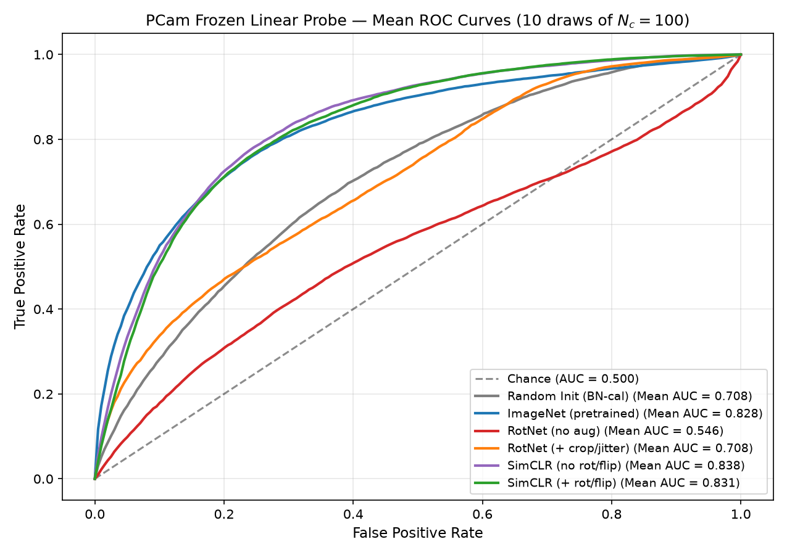

# Self-Supervised Pre-Training on PatchCamelyon (PCam): RotNet vs. Mini-SimCLR

A small-scale exploratory study comparing rotation-prediction pre-training (RotNet, motivated by Kupferschmidt et al., MIDL 2021) against a lightweight contrastive baseline (Mini-SimCLR) on 4,000 unlabeled PatchCamelyon (PCam) patches under a low-label downstream regime ($N_c = 100$ per class).

## Motivation & Experimental Setup

In *Strength in Diversity* (Kupferschmidt et al., MIDL 2021), pre-training a ResNet-34 on homogeneous PCam patches via 4-way rotation prediction underperformed random initialization under 100-epoch end-to-end fine-tuning at $N_c = 100$ (`67.8 ± 2.1%` vs. `74.1 ± 1.0%`). Because contrastive objectives have been shown to learn stronger histopathology representations than early geometric pretext tasks (e.g., Ciga et al., 2022), this pilot compares six ResNet-34 initializations on the same data and tests two confounds directly:

1. **Evaluation protocol:** Both frozen linear probing (`StandardScaler` + 5-fold `LogisticRegressionCV`, 10 labeled draws) and 100-epoch end-to-end fine-tuning (Adam `lr=1e-3`, `weight_decay=1e-3`, batch size 64, 3 labeled draws).
2. **Augmentation confound:** Ablations for `RotNet (+ crop/jitter)` (matching SimCLR's crop/color augmentations) and `SimCLR (no rot/flip)` (isolating whether explicit rotation invariance drives SimCLR's gain).
3. **Held-out pretext diagnostic:** 4-way rotation accuracy measured on unseen test patches (chance = `25.0%`).

**Data & Pre-Training Protocol:**
* **Source:** Shuffled streams (`buffer_size=10,000`, `seed=42`) from `1aurent/PatchCamelyon` official `train` and `test` splits.
* **Subsets:** 4,000 unlabeled patches (48.3% positive logged before stripping labels; RGB `mean=[0.6974, 0.5361, 0.6887]`, `std=[0.2373, 0.2789, 0.2151]`), 10 balanced draws of $N_c = 100$ (200 labeled images) from a separate 3,000-patch shuffled train pool, and 5,000 balanced holdout test patches.
* **SSL Training:** ResNet-34 from scratch, 30 epochs, effective batch size 256, Adam (`lr=1e-3`, `weight_decay=1e-3`), single pre-training seed (`42`).

## Results ($N_c = 100$ per class, 5,000 test patches)

All standard deviations are sample SDs (`ddof=1`) across downstream labeled draws.

| Initialization | Linear Probe Acc (10 draws) | Linear Probe AUC (10 draws) | Fine-Tune Acc (3 draws) | Fine-Tune AUC (3 draws) |
| :--- | :---: | :---: | :---: | :---: |
| **Random Init (BN-cal)** | $65.0 \pm 2.7\%$ | $0.708 \pm 0.032$ | $64.1 \pm 3.9\%$ | $0.701 \pm 0.048$ |
| **ImageNet (pretrained)** | $75.7 \pm 1.1\%$ | $0.828 \pm 0.015$ | $68.3 \pm 11.1\%$ | $0.746 \pm 0.129$ |
| **RotNet (no aug)** | $56.2 \pm 5.0\%$ | $0.546 \pm 0.099$ | $63.2 \pm 2.2\%$ | $0.684 \pm 0.030$ |
| **RotNet (+ crop/jitter)** | $63.1 \pm 1.8\%$ | $0.708 \pm 0.023$ | $66.4 \pm 4.9\%$ | $0.719 \pm 0.067$ |
| **SimCLR (no rot/flip)** | $76.4 \pm 1.3\%$ | $0.838 \pm 0.009$ | $65.9 \pm 2.0\%$ | $0.752 \pm 0.053$ |
| **SimCLR (+ rot/flip)** | $76.0 \pm 1.8\%$ | $0.831 \pm 0.019$ | $63.6 \pm 1.0\%$ | $0.692 \pm 0.027$ |

**Paired Linear-Probe Differences across identical draws ($n = 10$, `ddof=1`):**
* `SimCLR (+ rot/flip)` vs. `RotNet (no aug)`: $\Delta\text{Acc} = +19.8 \pm 4.6\%$, $\Delta\text{AUC} = +0.285 \pm 0.092$ (higher AUC on 10/10 draws).
* `SimCLR (+ rot/flip)` vs. `RotNet (+ crop/jitter)`: $\Delta\text{Acc} = +12.9 \pm 2.6\%$, $\Delta\text{AUC} = +0.123 \pm 0.030$ (higher AUC on 10/10 draws).
* `SimCLR (+ rot/flip)` vs. `SimCLR (no rot/flip)`: $\Delta\text{Acc} = -0.4 \pm 1.0\%$, $\Delta\text{AUC} = -0.007 \pm 0.013$ (higher AUC on 3/10 draws).

**Held-Out 4-Way Rotation Accuracy on 5,000 Unseen Test Patches (chance = `25.0%`):**
* `RotNet (no aug)`: **36.73%** (final train loss `0.3958`).
* `RotNet (+ crop/jitter)`: **40.87%** (final train loss `1.0434`).



## Findings

1. **RotNet degrades linear separability below an untrained baseline:** Without extra augmentation, `RotNet (no aug)` dropped well below a BatchNorm-calibrated random ResNet-34 under frozen linear probing (`56.2%` / `0.546` AUC vs. `65.0%` / `0.708` AUC) and slightly trailed random initialization under 100-epoch fine-tuning (`63.2%` vs. `64.1%`, overlapping error bars).
2. **Directional cues exist in PCam, but predicting them hurts downstream transfer:** Held-out rotation accuracy (`36.7%`–`40.9%`) is far above `25%` chance, showing that unseen test patches retain generalizable orientation cues rather than pure training memorization. Which visual features drive this signal (e.g., tissue anisotropy vs. acquisition/compression cues) was not investigated via saliency or occlusion analysis.
3. **Contrastive gains are not explained by explicit rotation invariance:** Adding crop and color jitter to RotNet only lifted linear-probe AUC back to the untrained random baseline (`0.708`). Conversely, removing discrete rotations and flips from SimCLR did not hurt performance (`0.838` vs. `0.831` AUC). In this small-scale regime, the contrastive instance-discrimination objective with crop/color augmentations—not explicit rotational invariance—accounts for the gap over RotNet, matching a frozen ImageNet ResNet-34 (`0.828` AUC) on the same test split.
4. **Unaugmented 100-epoch fine-tuning overfit across all models:** Every initialization performed worse and with higher variance under 100-epoch unaugmented fine-tuning on 200 images (e.g., ImageNet dropped from `75.7 ± 1.1%` frozen to `68.3 ± 11.1%` fine-tuned) than under a regularized frozen linear probe.

## Limitations & Protocol Deviations

* **Not an exact replication of Kupferschmidt et al. (2021):** This experiment pre-trains for 30 epochs instead of 100, omits source-dataset diversity (CRC, Tiny ImageNet, ALOT) and Jigsaw pre-training, and evaluates on a 5,000-patch subset rather than the full 32,768-patch test set.
* **Single SSL training seed:** Each SSL model was pre-trained once (`seed=42`); reported standard deviations capture sensitivity to the 200-image downstream draw (sampled from a shared 3,000-patch candidate pool) rather than SSL pre-training variance.
* **Split independence:** Official train/test splits from `1aurent/PatchCamelyon` are used, but slide IDs are not exposed in the dataset to independently verify patient-level separation.
* **Crop geometry:** `RandomResizedCrop(scale=(0.6, 1.0))` does not guarantee that the center $32 \times 32$ region determining PCam labels is preserved on every view.

## Repository Layout & Usage

```text
PCam_Self_Supervised_Learning/
├── README.md
├── requirements.txt
├── .gitignore
├── data_loader.py                  # Shuffled HF streaming, channel stats, and ablation transforms
├── models.py                       # ResNet-34 backbone, RotNet, SimCLR, and fine-tune classifier
├── train_ssl.py                    # RotNet & SimCLR training loops, BN calibration, held-out check
├── evaluate.py                     # Scaled CV linear probe, 100-epoch fine-tuning, and mean ROC plot
├── pcam_study_walkthrough.ipynb    # Executed end-to-end notebook with all logs and plots
└── roc_curves_comparison.png       # Mean ROC curves averaged across 10 linear-probe draws
```

```bash
pip install -r requirements.txt
jupyter notebook pcam_study_walkthrough.ipynb
```

## References & Disclosure

* Kupferschmidt, K. L., Teh, E. W., & Taylor, G. W. (2021). [*Strength in Diversity: Understanding the impacts of diverse training sets for self-supervised pre-training in histology.*](https://openreview.net/forum?id=cA4VVWbNO-) MIDL 2021.
* Chen, T., Kornblith, S., Norouzi, M., & Hinton, G. (2020). [*A Simple Framework for Contrastive Learning of Visual Representations.*](https://arxiv.org/abs/2002.05709) ICML 2020.
* Gidaris, S., Singh, P., & Komodakis, N. (2018). [*Unsupervised Representation Learning by Predicting Image Rotations.*](https://arxiv.org/abs/1803.07728) ICLR 2018.
* Ciga, O., Xu, T., & Martel, A. L. (2022). [*Self supervised contrastive learning for digital histopathology.*](https://doi.org/10.1016/j.mlwa.2021.100198) *Machine Learning with Applications*, 7, 100198 ([arXiv:2011.13971](https://arxiv.org/abs/2011.13971)).
* Veeling, B. S., Linmans, J., Winkens, J., Cohen, T., & Welling, M. (2018). [*Rotation Equivariant CNNs for Digital Pathology.*](https://arxiv.org/abs/1806.03962) MICCAI 2018 (PatchCamelyon dataset, accessed via [`1aurent/PatchCamelyon`](https://huggingface.co/datasets/1aurent/PatchCamelyon)).

*Disclosure: Code was drafted with AI coding assistance (Gemini) and reviewed, debugged, executed, and validated by the author.*
